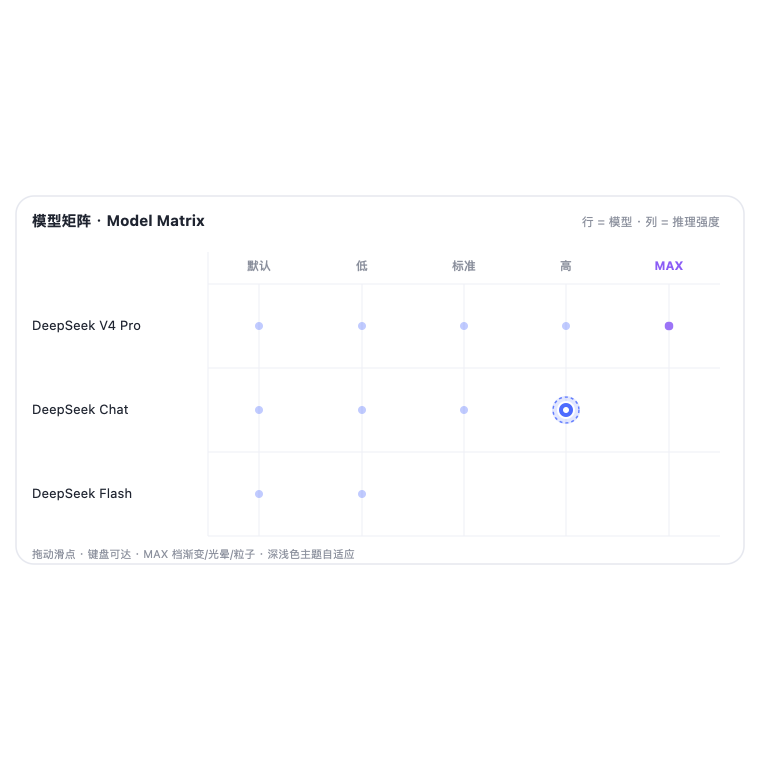

<div align="center">


# 模型矩阵 · Model Matrix

**把「选模型」和「选推理强度」两个动作，合成一次拖动。**

*Pick a model and its reasoning effort in one drag.*


</div>

---

## 它是什么

原生选择器要你先选模型、再去别处翻推理强度档位。**模型矩阵**把它们放进同一块二维网格：

- **行 = 模型**（按能力自动从上到下排序）
- **列 = 推理强度档位**（所有模型的档位并集）

拖动滑点吸附到交叉点，松手即确认「模型 + 智能度」组合。

## 为什么用它

| 原来的体验 | 矩阵的做法 |
|---|---|
| 模型和档位分开选，来回切换 | 一块网格，一次选完 |
| 档位因模型而异，容易点错 | 只显示该模型真实支持的档位 |
| 想快速比较不同档位 | 拖动即预览，松手才生效 |

## 特性

- 🎯 **一屏选全** —— 模型 × 推理强度两个维度合成一张矩阵。
- 🖱️ **拖动即选** —— 滑点跟手、吸附预览、松手确认；支持键盘（方向键移动，Enter/空格确认，Esc 关闭）。
- 🧠 **智能排序** —— 模型按能力排序，列是所有模型的推理档位并集。
- 🔌 **真实数据** —— 读写 DSH 会话状态（`modelSelection` / `modelCatalog` / `selectModel`），没有假数据。
- ✨ **精致细节** —— MAX 档渐变 + 光晕 + 粒子动效，深浅色主题自适应，尊重系统「减少动态效果」偏好。

## 效果预览



> 示意图；上线后可替换为真实操作 GIF。

## 快速开始

```bash
dsh plugin add dsh-model-matrix
```

或通过插件市场「发现」页安装：在 DSH「设置 → 插件 → 发现 → 索引来源」填入

```
https://Fyerl.github.io/dsh-model-matrix/docs/index.json
```

## 使用

1. 打开对话输入框，点击模型选择器位置。
2. 在矩阵里拖动滑点到目标交叉点。
3. 松手完成「模型 + 推理强度」切换。

## 兼容性

- DeepSeek Harness ≥ 0.2.1（Desktop / Web）
- 深浅色主题自适应

## 常见问题

<details>
<summary>为什么有些交叉点没有圆点？</summary>
矩阵只显示该模型真实支持的推理档位；不支持的组合不会出现，也点不到。
</details>

<details>
<summary>会修改账号的默认模型吗？</summary>
不会。它写的是当前会话的会话级选择（`selectModel`），不影响全局默认。
</details>

<details>
<summary>会话被子代理接管时能改吗？</summary>
不能，此时选择器会置灰并给出提示，符合 DSH 的路由约束。
</details>

## 贡献

欢迎提 issue 和 PR，详见 [CONTRIBUTING.md](./CONTRIBUTING.md)。

## 许可证

[MIT](./LICENSE)
